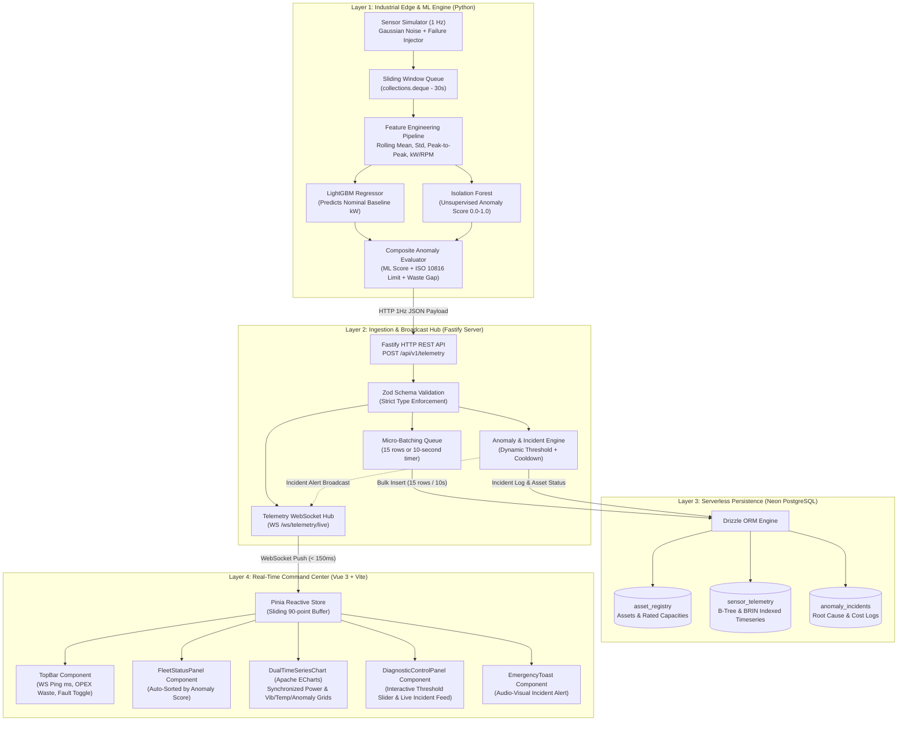

# 🛡️ VIGILUX — Industrial Energy & Asset Anomaly Watchdog
> **Condition-Based Monitoring (CBM) & Real-Time Energy Gap Intelligence Platform**

[](https://nodejs.org/)
[](https://www.typescriptlang.org/)
[](https://fastify.dev/)
[](https://vuejs.org/)
[](https://vitejs.dev/)
[](https://www.python.org/)
[](https://lightgbm.readthedocs.io/)
[](https://neon.tech/)
[](https://echarts.apache.org/)

---

## 1. Executive Summary & Industrial Business Problem

In heavy manufacturing and continuous process industries (mining, petrochemical, automotive stamping, power generation), rotating machinery such as high-capacity induction motors, multistage centrifugal pumps, and screw compressors represent critical single points of failure.

### The Hidden OPEX Drain: Mechanical Friction vs. Electrical Penalty
When industrial bearings undergo progressive mechanical degradation (inner race pitting, lubrication dry-out, roller wear):
1. **Frictional Surge**: Rotor friction increases exponentially, forcing the motor to draw **+25% to +40% excess active electrical power (kW)** just to maintain nominal RPM.
2. **Peak Demand Penalties**: Utility providers penalize facilities with severe peak kW demand charges. A single degraded 75 kW motor running unmonitored for an entire billing cycle can cause tens of thousands of dollars in avoidable utility surcharges.
3. **Catastrophic Failure & Unplanned Downtime**: If uncorrected, mechanical friction converts electrical power directly into destructive thermal energy (+15°C to +30°C thermal spikes) and destructive vibrational resonance (> 7.0 mm/s RMS), leading to catastrophic bearing seizure and emergency plant stoppage costing up to **$250,000 / hour** in lost production.

### The Vigilux Solution
**Vigilux** is a high-throughput, edge-to-cloud Condition-Based Monitoring (CBM) and Energy Waste Intelligence platform. By synthesizing continuous 1 Hz high-frequency multi-sensor streams with real-time Dual Machine Learning inference (`LightGBM` + `IsolationForest`), Vigilux:
- Calculates the instantaneous **Energy Waste Gap ($\Delta kW$)** between actual power consumption and an ML-predicted baseline.
- Flags nascent sub-surface mechanical degradation **weeks before thermal or vibrational alarms trigger**.
- Broadcasts actionable telemetry and financial diagnostics to command center engineers in **< 150 ms end-to-end latency**.

---

## 2. End-to-End System Architecture

Vigilux is architected as an industrial-grade monorepo employing **Clean Architecture** across data ingestion, machine learning inference, message routing, and reactive visualization.



---

## 3. Data Science & Machine Learning Specification

```
┌───────────────────────────────────────────────────────────────────────────────┐
│                      VIGILUX DUAL ML INFERENCE PIPELINE                       │
├───────────────────────┬───────────────────────────┬───────────────────────────┤
│ Model Component       │ Technique / Algorithm     │ Output / SLA Target       │
├───────────────────────┼───────────────────────────┼───────────────────────────┤
│ Baseline Power Model  │ LightGBM Regressor (GBDT) │ Predicted kW (R² = 0.979) │
│ Outlier Detector      │ Isolation Forest          │ Raw Score (-0.5 to +0.5)  │
│ Feature Windowing     │ In-Memory Sliding Deque   │ 30 timesteps rolling      │
│ Composite Calibration │ Physical ISO Fusion       │ Normalized Score [0, 1]   │
│ End-to-End Latency    │ OpenMP C++ Warmup         │ 7.2 ms (SLA < 15 ms)      │
└───────────────────────┴───────────────────────────┴───────────────────────────┘
```

### 3.1. In-Memory Sliding Window Feature Engineering
Rather than executing compute-heavy time-series window queries against the database, the Python ML Engine maintains a dedicated `collections.deque(maxlen=30)` per asset in RAM:

$$\bar{X}_t = \frac{1}{W} \sum_{i=0}^{W-1} x_{t-i}, \quad \sigma_t = \sqrt{\frac{1}{W-1} \sum_{i=0}^{W-1} (x_{t-i} - \bar{X}_t)^2}$$

For each metric $M \in \{\text{Power (kW)}, \text{Vibration RMS (mm/s)}, \text{Bearing Temperature (°C)}\}$, the engine computes:
- **Rolling Mean** ($\mu_{30}$)
- **Sample Standard Deviation** ($\sigma_{30}$, degrees of freedom = 1)
- **Peak-to-Peak Amplitude**: $\Delta_{p-p} = \max_{W}(X) - \min_{W}(X)$

### 3.2. Energy-to-Throughput Ratio
To differentiate between a machine operating under legitimate mechanical load versus one suffering from parasitic frictional drag:

$$\eta_{\text{throughput}} = \frac{P_{\text{active}} \text{ [kW]}}{\text{RPM} + \epsilon}, \quad \text{where } \epsilon = 1 \times 10^{-6}$$

Under normal conditions, $\eta_{\text{throughput}}$ remains strictly stationary. When bearing degradation begins, $\eta_{\text{throughput}}$ shifts upward by $+25\text{--}35\%$, signifying excessive electrical consumption per unit of rotational throughput.

### 3.3. LightGBM Supervised Power Baseline ($\hat{P}_{\text{nominal}}$)
A high-performance `LGBMRegressor` is trained on verified nominal baseline historical telemetry:

$$\hat{P}_{\text{nominal}} = f\left(\text{RPM}, \text{Pressure}, \text{Temp}, \mu_{\text{rpm}}, \mu_{\text{press}}, \mu_{\text{temp}}\right)$$

The model achieves an **$R^2$ coefficient of determination of 0.9790**, enabling precise quantification of the **Energy Waste Gap**:

$$\Delta kW_{\text{waste}} = \max\left(0, P_{\text{actual}} - \hat{P}_{\text{nominal}}\right)$$

$$\% \text{ Waste Gap} = \left(\frac{\Delta kW_{\text{waste}}}{P_{\text{actual}}}\right) \times 100$$

### 3.4. Composite Physical-Statistical Anomaly Score Calibration
Relying strictly on an `IsolationForest` decision function creates erratic score swings. Vigilux fuses the statistical model with physical ISO standards into a bounded $[0.00, 1.00]$ score:

$$S_{\text{composite}} = 0.40 \cdot \sigma\left(-k \cdot d_{\text{iForest}}\right) + 0.35 \cdot \min\left(1.0, \frac{\text{Vib}_{\text{RMS}}}{\text{Limit}_{\text{ISO}}}\right) + 0.25 \cdot \min\left(1.0, \frac{\Delta kW_{\text{waste}}}{0.30 \cdot P_{\text{rated}}}\right)$$

- **Healthy**: $S_{\text{composite}} < 0.65$ (Normal green glow)
- **Warning**: $0.65 \le S_{\text{composite}} \le 0.80$ (Amber alert, early micro-friction detected)
- **Critical**: $S_{\text{composite}} > 0.80$ (Crimson pulsing alert, automatic incident logging triggered)

---

## 4. API & Real-Time WebSocket Contract Specification

### 4.1. REST API Endpoints (`/api/v1`)

| Method | Endpoint | Description | Status Code |
| :--- | :--- | :--- | :--- |
| `POST` | `/api/v1/telemetry` | Ingests 1 Hz sensor package + ML inferences into micro-batch queue | `202 Accepted` |
| `GET` | `/api/v1/assets` | Returns all registered industrial assets enriched with live status | `200 OK` |
| `GET` | `/api/v1/assets/:asset_id/metrics` | Retrieves MTBF, Shift kWh, Waste Gap, and incident logs | `200 OK` |
| `POST` | `/api/v1/demo/simulate-failure` | Toggles bearing wear injection on target machine (`MOTOR-03`) | `200 OK` |
| `GET` | `/api/v1/demo/status` | Synchronizes simulation state and alarm threshold with ML engine | `200 OK` |
| `GET` | `/api/v1/telemetry/latest` | Fast in-memory cache lookup of all assets' current metrics | `200 OK` |

#### Sample Ingestion Payload (`POST /api/v1/telemetry`)
```json
{
  "asset_id": "MOTOR-03",
  "timestamp": "2026-10-21T08:30:00.000Z",
  "kw": 19.45,
  "rpm": 1478.2,
  "temp_c": 64.8,
  "vib_rms": 6.82,
  "pressure": 5.42,
  "predicted_kw": 14.52,
  "waste_gap_kw": 4.93,
  "waste_pct": 25.35,
  "anomaly_score": 0.842,
  "status": "Critical"
}
```

### 4.2. WebSocket Streaming (`WS /ws/telemetry/live`)
- **Transport**: Native WebSocket over Fastify `@fastify/websocket`.
- **Latency SLA**: $< 150\text{ ms}$ broadcast latency (Measured RTT: $1\text{--}4\text{ ms}$).
- **Heartbeat & Anti-Memory-Leak**: 30s ping/pong monitor with auto-purge for stale sockets.
- **Client Latency Tracking**: Client dispatches `{"type": "PING"}` every 5s; server immediately responds with `{"type": "PONG"}` to update the live UI ms latency counter.

---

## 5. Interactive Demo Walkthrough ("Simulate Failure Scenario")

Vigilux is equipped with a real-time deterministic failure injection engine designed to showcase condition-based monitoring in live demonstrations:

```
Normal Operation (1.8 mm/s, 46°C, 14.5 kW)
     │
     ▼  [User clicks '⚡ SIMULATE FAULT']
Progressive Mechanical Degradation
     │
     ├── Step 1: Micro-cracking & Lubrication Breakdown
     │           Vibration rises (1.8 -> 4.2 mm/s), Power drifts (+10%)
     │
     ├── Step 2: ISO Vibration Limit Exceeded (4.5 mm/s)
     │           Friction accelerates: Temp climbs (+18°C), Power spikes (+34%)
     │           Dual ML detects Anomaly Score crossing Alarm Threshold (0.80)
     │
     └── Step 3: Critical State Triggered
                 Asset automatically glides to top of Fleet Status panel
                 Card pulses crimson: 'ISO Vibration Exceeded!'
                 Emergency Toast banner pops up with financial impact:
                 'High Friction Warning: MOTOR-03 drawing excess kW ($0.74/hr waste)'
```

### How to Run the Demo:
1. In the header bar, click the **`⚡ SIMULATE FAULT`** button.
2. The button updates immediately to a pulsing warning state: **`🔥 FAULT: MOTOR-03 [STOP]`**.
3. Watch the **`FleetStatusPanel`** on the left: `MOTOR-03` anomaly score climbs from `0.12` past `0.80`, smoothly gliding to the **very top of the list** via hardware-accelerated CSS reordering transitions.
4. Watch the **`DualTimeSeriesChart`** in the center:
   - **Top Grid**: Actual power (Cyan curve) surges above the LightGBM baseline (dashed line), highlighting the **crimson-shaded Energy Waste Gap area**.
   - **Bottom Grid**: Vibration RMS and Temperature climb, while the Anomaly Score intersects the red dashed **`markLine`**.
5. Adjust the **Interactive Alarm Threshold Slider** (range `0.50` to `0.95`): Notice how the fleet machine statuses and chart alarm lines adapt dynamically in real-time.
6. Click **`🔥 FAULT: MOTOR-03 [STOP]`** again to recover the motor back to nominal operating condition.

---

## 6. Installation & Single-Command Launch Guide

### 6.1. Prerequisites
- **Node.js**: v20.x or v22.x LTS ([Download](https://nodejs.org/))
- **pnpm**: v10.x or v12.x (`npm install -g pnpm`)
- **Python**: v3.10+ with `pip` ([Download](https://www.python.org/))
- **PostgreSQL Database**: Free cloud instance from [Neon.tech](https://neon.tech/)

### 6.2. Step-by-Step Setup

#### 1. Clone & Install Dependencies
```bash
# Clone the repository
git clone https://github.com/your-username/vigilux.git
cd vigilux

# Install monorepo Node dependencies
pnpm install

# Install Python ML dependencies
pip install -r apps/ml-engine/requirements.txt
```

#### 2. Configure Environment Variables
Copy the root `.env.example` into each sub-application:
```bash
# Root Monorepo
cp .env.example .env

# Server Application
cp apps/server/.env.example apps/server/.env

# ML Engine Application
cp apps/ml-engine/.env.example apps/ml-engine/.env

# Web Application
cp apps/web/.env.example apps/web/.env
```
> **Note**: Update `DATABASE_URL` in `apps/server/.env` with your Neon PostgreSQL connection string.

#### 3. Database Migration & Seeding
```bash
# Push Drizzle schema to Neon PostgreSQL
pnpm run db:push

# Seed initial industrial assets (MOTOR-01 to COMP-01)
pnpm run db:seed
```

#### 4. Train Machine Learning Models
```bash
# Generates training dataset, trains IsolationForest & LightGBM, and saves .joblib artifacts
pnpm run ml:train
```

---

### 6.3. Launch All Services with a Single Command

Run the entire ecosystem concurrently in one terminal with labeled colored logs:

```bash
pnpm run dev
```

This single command triggers `concurrently` to launch:
- 🟦 **`SERVER`**: Fastify backend listening on [http://localhost:3000](http://localhost:3000) & WebSocket at `ws://localhost:3000/ws/telemetry/live`.
- 🟪 **`ML-SIM`**: Python 1 Hz multi-machine telemetry generator & sub-15 ms real-time ML predictor.
- 🟩 **`WEB-UI`**: Vue 3 + Vite responsive Command Center dashboard running on [http://localhost:5173](http://localhost:5173).

---

## 7. Monorepo Scripts Reference

| Command | Action |
| :--- | :--- |
| `pnpm run dev` | Concurrently starts Fastify Server, Python ML Simulator, and Vue 3 Frontend |
| `pnpm run dev:server` | Starts Fastify backend with hot reload (`tsx watch src/server.ts`) |
| `pnpm run dev:ml` | Starts Python sensor generator and real-time inference pipeline |
| `pnpm run dev:web` | Starts Vue 3 + Vite development server |
| `pnpm run build` | Compiles both `@vigilux/server` (`tsc`) and `@vigilux/web` (`vue-tsc && vite build`) |
| `pnpm run db:push` | Synchronizes Drizzle ORM schema with remote PostgreSQL database |
| `pnpm run db:seed` | Populates database with default assets (`MOTOR-01` to `COMP-01`) and baseline metrics |
| `pnpm run ml:train` | Retrains `IsolationForest` and `LightGBM` models and updates `.joblib` artifacts |

---

## 8. Technology Stack Summary

- **Frontend**: Vue 3 (Composition API, `<script setup lang="ts">`), Vite 6, Pinia, Apache ECharts 5, `vue-echarts`, Tailwind CSS 3, Lucide Icons, Google Fonts (`Inter`, `JetBrains Mono`).
- **Backend**: Node.js, TypeScript 5.7, Fastify 5, `@fastify/websocket`, Drizzle ORM, Zod, Postgres.js.
- **Database**: Neon Serverless PostgreSQL (B-Tree & BRIN indexed time-series tables).
- **Machine Learning**: Python 3.10+, LightGBM, Scikit-learn (`IsolationForest`), NumPy, Pandas, Joblib.
- **Monorepo Tools**: pnpm Workspaces, Concurrently.

---

## 9. License

This project is licensed under the **MIT License** — feel free to use and adapt it for industrial IoT and predictive maintenance research.
